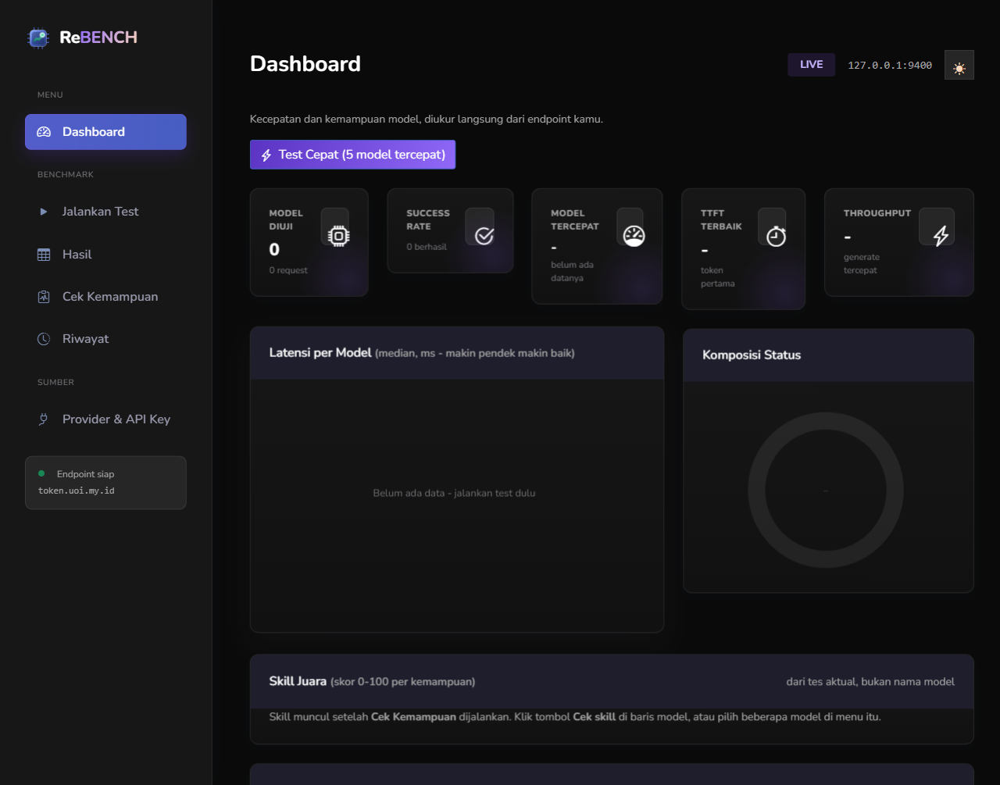

# ReBENCH



Benchmark model AI dari endpoint provider kamu sendiri: ukur kecepatan (TTFT, latensi total, token/detik) sekaligus kemampuan nyata (pintar, koding, vision, texting, reasoning, solusi).

Dashboard untuk mengukur model AI secara aktual: mana yang cepat, mana yang benar-benar bisa coding/JSON/vision.

## Fitur visual

- Chart latensi interaktif: hover per bar menampilkan tooltip (median, TTFT, tok/s).
- Donut status dengan animasi sweep.
- Kartu statistik dengan angka yang dianimasikan, ripple di setiap tombol, indikator busy saat request jalan.
- Transisi halaman bertahap, sidebar slide, topbar blur saat scroll, toast dengan progress bar.
- Keyboard: `1`–`6` untuk pindah menu.
- Menghormati `prefers-reduced-motion`.

## Jalankan

```bat
cd rebenth
npm install
npm start
```

Buka http://127.0.0.1:9400

## Alur

1. **Provider & API Key** — tempel base URL (`.../v1`) dan API key milikmu. Disimpan ke `config.json`, langsung diuji koneksinya, dan daftar model dibaca otomatis dari `/models`. Ganti provider kapan saja tanpa restart.
2. **Jalankan Test** — pilih model (atau klik **Pilih 5 tercepat**), atur prompt/max token/run, tekan **Mulai Benchmark**. Hasil mengalir realtime (NDJSON).
3. **Cek Kemampuan** — 9 tes aktual per model: chat dasar, patuh instruksi, matematika, output JSON, coding, recall konteks, routing, vision, konsistensi. Skor 0–100 + badge kemampuan.
4. **Dashboard** — kartu ringkas, chart latensi, donut status, leaderboard.
5. **Riwayat** — 100 run terakhir tersimpan di `results.json`.

## Metrik

| Metrik | Arti |
| --- | --- |
| TTFT | waktu sampai token pertama (persepsi "cepat") |
| Median total | waktu respons penuh, tahan outlier |
| Tok/s | kecepatan generate |
| Jitter | selisih latensi antar-request identik |
| Skor | jumlah tes lulus / total tes × 100 |

## Catatan

- `config.json` berisi API key plaintext — jangan di-commit.
- Tes vision memakai gambar 1×1; model yang menjawab "tidak bisa melihat gambar" akan ditandai gagal vision (ini tes jujur, bukan anggapan dari nama model).
- `concurrency` default 3 agar tidak kena rate limit provider.


## Skill per model

Kolom **Skill** di leaderboard berisi 6 angka 0-100, dihitung dari tes nyata + hasil benchmark:

| Skill | Sumber nilai |
| --- | --- |
| Pintar | skor keseluruhan tes kemampuan |
| Koding | tes menulis fungsi + patuh instruksi ketat |
| Vision | tes gambar asli (lulus = 100, gagal = 0) |
| Texting | median latensi (70%) + throughput (30%) |
| Reasoning | tes matematika + recall konteks |
| Solusi | JSON + routing + konsistensi + success rate |

Skill muncul setelah **Cek Kemampuan** dijalankan untuk model itu. Tombol **Cek skill** di baris tabel menjalankan tes hanya untuk model tersebut.

## Tema

UI memakai tema **Mazer** (Bootstrap 5). Semua aset disimpan lokal, tidak ada CDN saat runtime:

| File | Isi |
| --- | --- |
| `public/vendor/mazer/app.css` | style inti Mazer |
| `public/vendor/mazer/app-dark.css` | mode gelap (`data-bs-theme=dark`) |
| `public/vendor/mazer/bootstrap-icons.css` + `fonts/` | ikon `bi bi-*` |
| `public/rebenth.css` | penyesuaian ReBENCH: kartu statistik, tabel, chart, chip model, toast |
| `public/anim.css` | lapisan animasi (rise, ripple, pin chip, hover chart) |

CSS lama SB Admin 2 disimpan di `public/legacy/` dan tidak dipakai lagi.

### Mode gelap

Tombol bulan/matahari di header (atau tekan **D**) mengganti tema. Pilihan disimpan di `localStorage` kunci `rebenth-theme` dan dipasang sebelum paint pertama, jadi tidak ada kedip putih saat reload.

Palet gelap mengikuti mockup: latar `#0a0a0a`, sidebar 272px `#171717`, kartu gradien `#171717 -> #111111`, aksen ungu `#8b5cf6` / `#9069f9`, peach `#fbd7bd`, sky `#0ea5e9`, chip `#262626`, garis `rgba(255,255,255,.08)`.

Catatan teknis: aturan gelap ReBENCH memakai selector `html[data-bs-theme=dark] ...` supaya menang atas aturan Mazer dengan spesifisitas sama-plus. `applyTheme()` juga membatalkan transisi warna yang menggantung agar nilai baru langsung terpakai.
